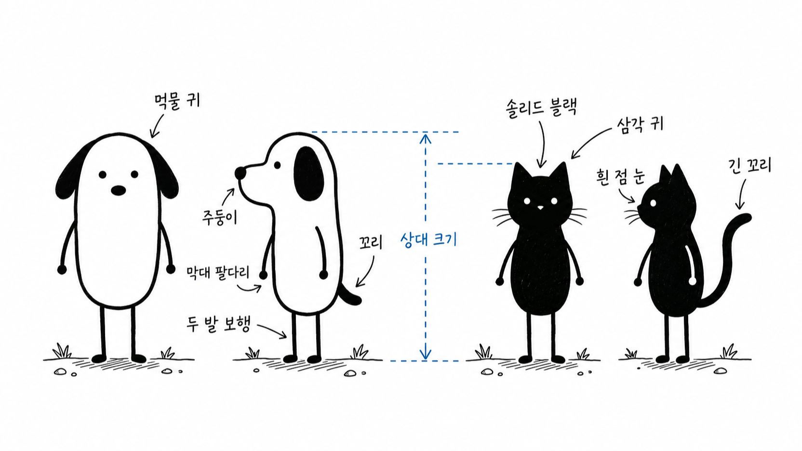
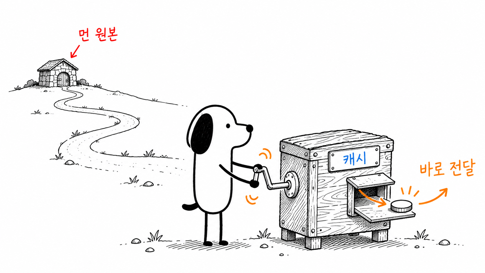
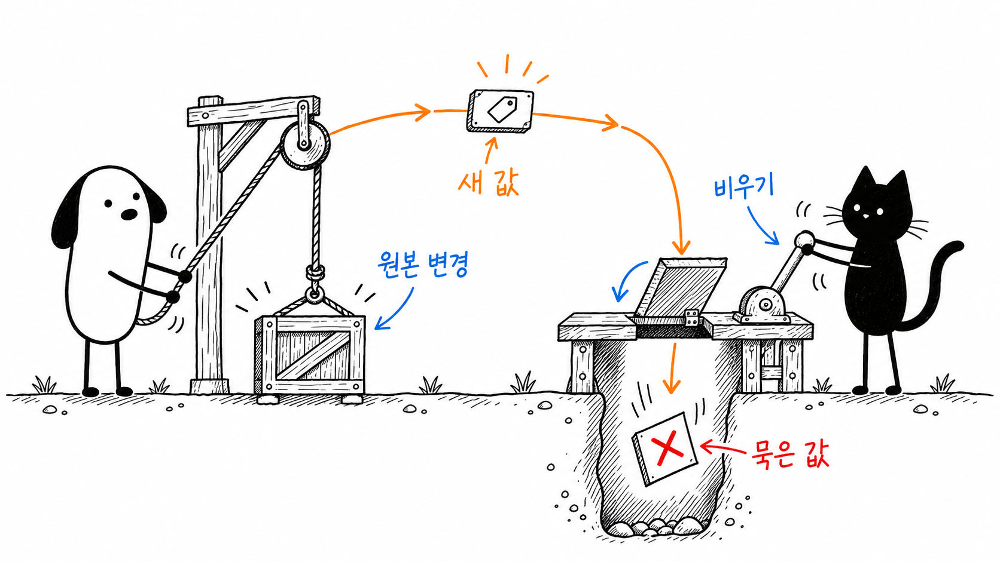

# Pet Sketch Illustrations (`pet-sketch-illustrations`)

한국어 기술 글과 개발 블로그 본문에 들어갈 손그림 설명 삽화(16:9 PNG)를 기획, 생성, 편집, 저장하는 Agent Skill입니다.

Ian의 원작([ian-xiaohei-illustrations](https://github.com/helloianneo/ian-xiaohei-illustrations))과 영어판([ian-xiaohei-illustrations-en](https://github.com/tojileon/ian-xiaohei-illustrations-en))의 화이트보드 펜 스케치 문법을 계승하고, **이족 보행 캡슐 강아지**와 **이족 보행 솔리드 블랙 고양이** 캐릭터 IP를 도입하여 한국어 기술 문서에 최적화했습니다.

## 주요 특징

- **원저자 잉크 펜 문법**: 순백색 배경(#FFFFFF), 가늘고 흔들리는 검은 잉크 펜 선, 평행 해칭·지면선·동작선(`(( ))`), 넉넉한 여백(40% 이상).
- **이족 보행 의인화 캐릭터**: 사람처럼 두 발로 걷고 두 팔(가는 막대 팔다리)을 쓰는 덤덤한 작업자 **캡슐 강아지**와 **솔리드 블랙 고양이**가 로우테크 장치를 직접 조작합니다.
- **3색 주석 문법**: 주황(흐름·화살표), 빨강(문제·경고·낡은 값), 파랑(조작·상태·메타 정보)을 1~3단어 짧은 한국어 손글씨 주석에 절제해 사용합니다.
- **4가지 실행 모드**:
  - `plan_only`: 이미지 생성 없이 본문 위치, 설명할 개념, 캐릭터 행동, 한국어 주석 구상 (도구 호출 0회).
  - `generate`: 기본 3장(또는 요청된 장수) 순차 개별 생성 및 사전 압축 명세표 제시.
  - `edit`: 좌상단 제목 제거, 주석 문구 변경, 캐릭터 참여도 수정 등 부분 수정.
  - `save`: `<workspace-root>/assets/<article-slug>-illustrations/` 경로에 순번 파일명(`01-topic.png`)으로 저장하며, 중복 시 `-v2`, `-v3` 접미사로 원본 보존.

## 캐릭터 기준 및 시범 예제

### 캐릭터 기준 시트


### 캐시 조회 (`01-cache-lookup-v4.png`)


### 캐시 무효화 및 갱신 (`02-cache-invalidation-v4.png`)


## 환경별 설치 및 실행 가이드

| 환경 | 설치 경로 | 실행 동작 및 도구 |
|---|---|---|
| **Codex** | `.agents/skills/pet-sketch-illustrations/` | 구상, 내장 이미지 도구(`image_gen`)로 생성·편집, 로컬 PNG 저장 |
| **Google Antigravity** | `.agents/skills/pet-sketch-illustrations/` | 구상, 내장 `image-generator`로 생성·편집, 작업 폴더에 PNG 저장 |
| **Claude Code** | `.claude/skills/pet-sketch-illustrations/` | 한국어 구상 및 프롬프트 생성 (이미지 도구 미연결 시 명세/프롬프트 제공, 필요시 MCP 연결) |
| **Claude Web** | ZIP 압축 업로드 | 구상 및 업로드된 이미지 검수, 결과물 다운로드 방식 안내 |

## 설치 방법

### 1. Codex & Google Antigravity
프로젝트 루트 또는 작업 공간 아래에 `.agents/skills/` 디렉토리를 생성하고 본 Skill 폴더를 복사합니다:

```bash
mkdir -p .agents/skills
cp -r pet-sketch-illustrations .agents/skills/
```

### 2. Claude Code
`.claude/skills/` 디렉토리에 복사합니다:

```bash
mkdir -p .claude/skills
cp -r pet-sketch-illustrations .claude/skills/
```

## 검증 및 테스트

```bash
npm test
```

## 출처 및 라이선스

- 원작: Ian Xiaohei Illustrations by [Ian](https://github.com/helloianneo)
- 영어판: Ian Xiaohei Illustrations English by [tojileon](https://github.com/tojileon)
- 라이선스: MIT License (`LICENSE`, `NOTICE.md` 참조)
